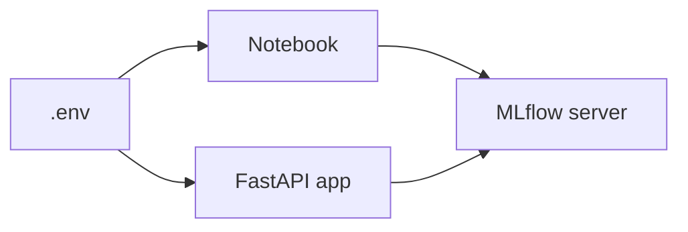

# Run MLflow Locally

This step sets up the local service that both the notebook and the FastAPI application use. The goal is to keep the whole deployment workflow on your machine without depending on any remote artifact storage.

## What This Service Does

The local MLflow server gives you:

- experiment tracking on `http://127.0.0.1:5000`;
- a local Model Registry;
- artifact storage in the `mlartifacts/` folder;
- a SQLite metadata database in `mlflow.db`.

## Start The Tracking Server

From the repository root, activate your virtual environment and run:

```bash
source .venv/bin/activate
mlflow server \
  --host 127.0.0.1 \
  --port 5000 \
  --backend-store-uri sqlite:///mlflow.db \
  --default-artifact-root ./mlartifacts
```

Keep this terminal window open while you work through the notebook and the API.

Expected result:

- the terminal stays busy because the MLflow server is running
- the MLflow UI is available at `http://127.0.0.1:5000`
- `mlflow.db` is created in the repository root
- `mlartifacts/` appears after the notebook logs the model

## Configure The Environment File

Copy the example environment file once:

### `macOS` / Linux

```bash
cp .env.example .env
```

### `Windows`

```powershell
Copy-Item .env.example .env
```

The default values already point to the local tracking server:

- `MLFLOW_TRACKING_URI=http://127.0.0.1:5000`
- `REGISTERED_MODEL_NAME=lr-ride-duration`
- `MODEL_ALIAS=production`



## Run The Notebook In VS Code

Open [src/register_mlflow_model.ipynb](src/register_mlflow_model.ipynb) in VS Code and select your `.venv` interpreter as the Jupyter kernel.

The notebook is intentionally small and runnable:

1. it builds a compact demo dataset;
2. it trains a scikit-learn regression pipeline;
3. it logs the model to MLflow;
4. it registers the model and assigns the `production` alias.

Once the notebook finishes, you should see the registered model in the MLflow UI under `Models`.

If the notebook cannot find the `.venv` kernel, reopen VS Code after creating the environment and select the interpreter again from the notebook toolbar.

The notebook loads `.env` from the repository root whether VS Code starts the kernel in the root folder or inside `src/`.
