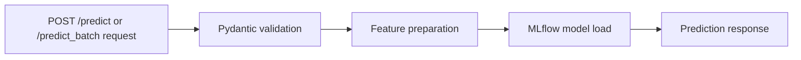

# Run The FastAPI App Locally

Now that the model is registered in local MLflow, you can serve predictions from a local FastAPI application.

## API Files

The local API lives in the [webservice_locally](webservice_locally) folder:

- `app.py` defines the FastAPI routes;
- `data_model.py` defines the request and response schemas with Pydantic;
- `predict.py` loads `lr-ride-duration@production` from the local MLflow registry and returns single or batch predictions.



## Routes At A Glance

| Route | Input | Output | Use it when |
| --- | --- | --- | --- |
| `GET /` | no body | project health message | checking that the app is alive |
| `POST /predict` | one taxi ride | one ride plus `predicted_duration` | scoring a single example |
| `POST /predict_batch` | list of taxi rides | list of predictions in request order | scoring several examples together |

If you send an empty list to `POST /predict_batch`, the API returns `[]`. That keeps the behavior predictable for callers that build requests dynamically.

## Start The API

From the repository root:

```bash
source .venv/bin/activate
uvicorn webservice_locally.app:app --reload --port 9696
```

Once the server is running, open [http://127.0.0.1:9696/docs](http://127.0.0.1:9696/docs) to inspect the interactive API documentation.

If you see a model-loading error here, go back to step `01` and confirm that:

- the MLflow server is still running
- the notebook finished successfully
- the registered model has the `production` alias

The most useful debugging order is: first check MLflow, then check the model alias, then restart the API. Restarting matters because the API loads the model when a prediction request runs.

## Example Request

```bash
curl -X POST http://127.0.0.1:9696/predict \
  -H "Content-Type: application/json" \
  -d '{
    "ride_id": "ride-101",
    "PULocationID": 161,
    "DOLocationID": 236,
    "trip_distance": 3.5
  }'
```

## Expected Response Shape

The exact prediction value will vary depending on the model version you registered, but the response will look like this:

```json
{
  "ride_id": "ride-101",
  "PULocationID": 161,
  "DOLocationID": 236,
  "trip_distance": 3.5,
  "predicted_duration": 910.42
}
```

## Batch Prediction Request

Use `POST /predict_batch` when you want to score several rides in one request:

```bash
curl -X POST http://127.0.0.1:9696/predict_batch \
  -H "Content-Type: application/json" \
  -d '[
    {
      "ride_id": "ride-201",
      "PULocationID": 161,
      "DOLocationID": 236,
      "trip_distance": 3.5
    },
    {
      "ride_id": "ride-202",
      "PULocationID": 142,
      "DOLocationID": 239,
      "trip_distance": 1.7
    }
  ]'
```

The response is a list with one prediction object per input ride, in the same order.

## Suggested Local Checks

- Visit `GET /` to confirm the app is running.
- Use `/docs` to inspect the request schema.
- Try a few different `trip_distance` values and compare the predicted durations.
- Try `POST /predict_batch` and confirm the response order matches the request order.
- Run [04-test-and-extend-the-api.md](04-test-and-extend-the-api.md) before making code changes.
