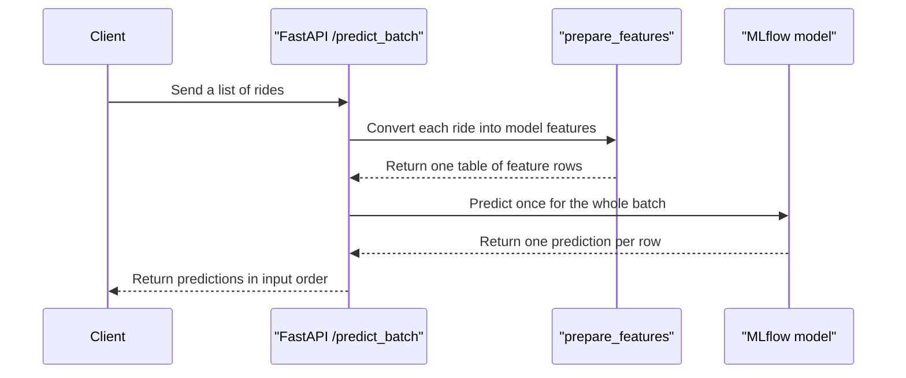

# Test and Extend the API

Once the notebook, MLflow server, and FastAPI app work together locally, the next useful step is to protect that workflow with a couple of tests and then make one small extension.

## Why This Step Matters

The earlier steps prove the project works. This step helps you keep it working while you make changes.


## Included Test File

This repo includes [tests/test_app.py](tests/test_app.py):

- one test checks that `GET /` returns the expected message
- one test checks that `POST /predict` returns the original payload plus a prediction field
- one test checks that `POST /predict_batch` returns one prediction per input ride
- one test checks that an empty batch returns an empty response without loading a model

The prediction tests mock the model calls so they do not depend on a running MLflow server. That keeps the tests fast and focused on API behavior.

## Run The Tests

From the repository root:

### `macOS` / Linux

```bash
source .venv/bin/activate
pytest
```

### `Windows`

```powershell
.venv\Scripts\Activate.ps1
pytest
```

Expected result:

- all four tests pass
- the output ends with a short `4 passed` summary

## What The Tests Cover

| Area | What it checks | Why it helps |
| --- | --- | --- |
| `GET /` | the app starts and responds with the expected message | confirms the API entrypoint is wired correctly |
| `POST /predict` | the route accepts a valid payload and returns `predicted_duration` | confirms request parsing and response formatting work |
| `POST /predict_batch` | the route accepts a list and preserves response order | confirms batch requests stay aligned with input rides |
| `POST /predict_batch` with `[]` | the route returns `[]` without loading a model | keeps empty requests cheap and predictable |

## Implemented Extension

This repo now includes a small `POST /predict_batch` endpoint that accepts a list of rides and returns a list of predictions.

The implementation follows this workflow:

1. `predict.py` builds one feature table for all rides
2. the MLflow model is loaded once for the whole batch
3. `app.py` returns one `TaxiRidePrediction` per input ride
4. `tests/test_app.py` confirms the batch response shape and order



## Deliverable Checklist

When you make the next API change, aim to leave the repo in this state:

- the route appears in `/docs`
- `pytest` still passes
- the behavior is described in the relevant markdown file
- the change still works with the local MLflow setup from steps `01` and `02`
