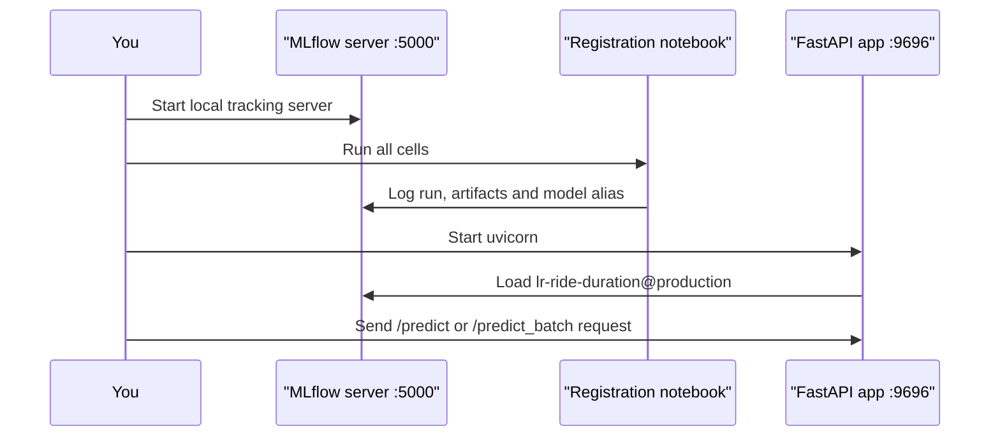
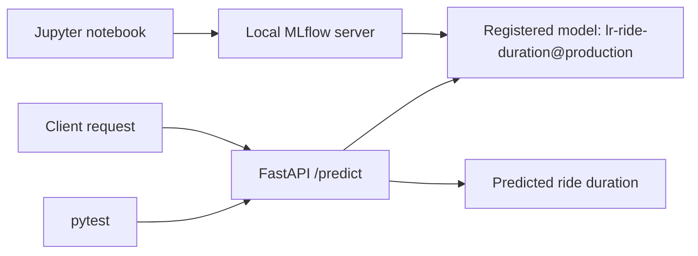

# Deploy a Local ML Model API with FastAPI, MLflow and Docker

This repository shows a local-first deployment workflow for a machine learning model. You will create and register a small demo taxi-duration model in MLflow, serve it through a FastAPI application, test the API locally, and package it in Docker once the core flow works.

## Learning Path

- [01 - Run MLflow locally](01-run-local-mlflow.md): Start a local MLflow tracking server with a SQLite backend and local artifact storage.
- [src/register_mlflow_model.ipynb](src/register_mlflow_model.ipynb): Run the notebook to log and register the `lr-ride-duration@production` demo model.
- [02 - Run FastAPI app locally](02-run-the-api-locally.md): Start the FastAPI application in [webservice_locally](webservice_locally) and send a prediction request.
- [03 - Test the API](03-test-the-api.md): Run the test suite.
- [04 - Run the API in Docker](04-run-with-docker.md): Build and run the API in Docker against the same local MLflow server.

The workflow has three moving parts. Keep each long-running service in its own terminal so it is easy to read logs and stop processes cleanly with `Ctrl + C`.



## Local Data Services

This repository uses one local service:

- `MLflow tracking server` on <http://127.0.0.1:5000>. It stores experiment metadata in `mlflow.db` and model artifacts in `mlartifacts/`.

The FastAPI app runs locally on <http://127.0.0.1:9696> and loads the registered model from the MLflow Model Registry using the `production` alias.



## Environment

Please make sure you **use this repository as a template** and set up a new virtual environment. You can use the following commands:

### **`macOS`** / **`Linux`**

```bash
pyenv local 3.11.3
python -m venv .venv
source .venv/bin/activate
python -m pip install --upgrade pip
python -m pip install -r requirements.txt
```

### **`Windows`**

For `Git Bash` CLI:

```bash
pyenv local 3.11.3
python -m venv .venv
source .venv/Scripts/activate
python -m pip install --upgrade pip
python -m pip install -r requirements.txt
```

For `PowerShell` CLI:

```powershell
pyenv local 3.11.3
python -m venv .venv
.venv\Scripts\Activate.ps1
python -m pip install --upgrade pip
python -m pip install -r requirements.txt
```

## Setup

You will need **Docker Desktop** installed and running on your machine. If you do not have it installed, please follow the [installation instructions](https://docs.docker.com/get-docker/).

## End-To-End Checklist

Use this checklist when you want to confirm the repository is healthy from a clean local state:

| Check | Command or page | Healthy result |
| --- | --- | --- |
| Local config | `.env` | Points to `http://127.0.0.1:5000` |
| MLflow UI | <http://127.0.0.1:5000> | Opens and shows the local tracking server |
| Model Registry | MLflow `Models` page | `lr-ride-duration` has the `production` alias |
| API docs | <http://127.0.0.1:9696/docs> | Shows `/predict` and `/predict_batch` |
| Tests | `pytest` | Ends with `4 passed` |

## Learning Objectives

By the end of this repository, you should be able to:

- Explain how MLflow tracking and the Model Registry support local deployment workflows.
- Run a FastAPI application that serves predictions from a registered model.
- Structure request and response payloads with Pydantic.
- Write small smoke tests for an API route before making larger changes.
- Move from a local development workflow to a Docker-based runtime.

## Quiz

1. **What is the purpose of using Pydantic in the FastAPI application?**  
   [ ] To connect to the MLFlow server  
   [ ] To deploy the application to a remote cloud platform  
   [ ] To provide runtime checking and validation of data structures  
   [ ] To create Docker containers  

   <details>
      <summary>Show Answer</summary>

      **Correct Answer:** To provide runtime checking and validation of data structures

      **Description:** In the FastAPI application, Pydantic is used to validate the data sent to the API (request body) and to parse the response data, ensuring data integrity and type safety.
   </details>

---

2. **Which function is used to load a model from the MLflow Model Registry in the `predict.py` file?**  
   [ ] mlflow.pyfunc.load_model()  
   [ ] mlflow.sklearn.load_model()  
   [ ] mlflow.load_model()  
   [ ] mlflow.get_model()  

   <details>
      <summary>Show Answer</summary>

      **Correct Answer:** mlflow.pyfunc.load_model()

      **Description:** The `mlflow.pyfunc.load_model()` function is used to load the registered model. In this repository, the API loads the model by name and alias from the local MLflow Model Registry.
   </details>

---

3. **What is the role of the local MLflow tracking server in this repository?**  
   [ ] It only hosts the FastAPI application  
   [ ] It stores experiment runs, registered models and model artifacts locally  
   [ ] It replaces Docker Desktop  
   [ ] It validates Pydantic schemas  

   <details>
      <summary>Show Answer</summary>

      **Correct Answer:** It stores experiment runs, registered models and model artifacts locally

      **Description:** The local MLflow server tracks runs, stores logged artifacts, and exposes the Model Registry that the FastAPI service reads from when loading the production model.
   </details>

---

4. **Why does the API convert a single request into a one-row table before calling `model.predict()`?**  
   [ ] Because FastAPI only supports table inputs  
   [ ] Because Pydantic requires a pandas DataFrame  
   [ ] Because Docker needs CSV-style payloads  
   [ ] Because MLflow pyfunc models typically expect tabular input  

   <details>
      <summary>Show Answer</summary>

      **Correct Answer:** Because MLflow pyfunc models typically expect tabular input

      **Description:** Even when you send only one prediction request, MLflow pyfunc models usually expect a tabular structure such as a pandas DataFrame. The API wraps the engineered features into a single-row table before calling the model.
   </details>

---

5. **What is the purpose of the `production` alias in the Model Registry?**  
   [ ] It renames the FastAPI route  
   [ ] It marks which registered model version the API should load  
   [ ] It creates a Docker image tag  
   [ ] It starts the MLflow server  

   <details>
      <summary>Show Answer</summary>

      **Correct Answer:** It marks which registered model version the API should load

      **Description:** Aliases let you point the API at a stable name such as `production` instead of hard-coding a specific version number. That makes model promotion easier when you register a new version later.
   </details>

---

6. **Why is Docker the last step in the workflow?**  
   [ ] Because Docker cannot run Python  
   [ ] Because MLflow does not work in containers  
   [ ] Because a notebook editor replaces Docker  
   [ ] Because the recommended order is to validate the local Python workflow first  

   <details>
      <summary>Show Answer</summary>

      **Correct Answer:** Because the recommended order is to validate the local Python workflow first

      **Description:** Local development is easier to debug directly in Python. Once the notebook, MLflow server, and API work together locally, packaging the API in Docker becomes much easier to reason about.
   </details>
