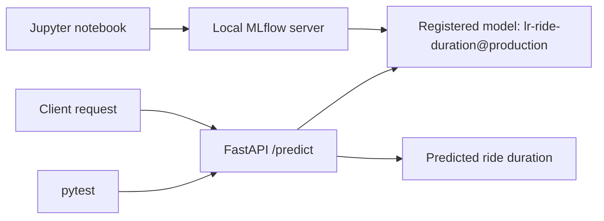
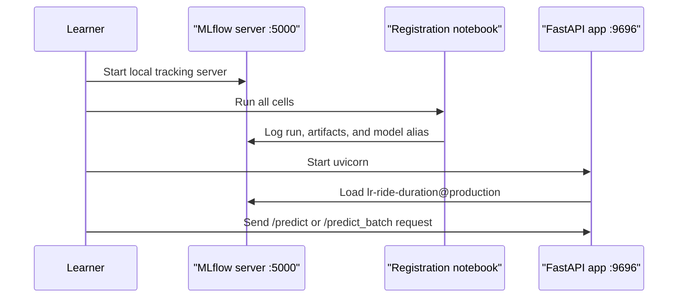

# Deploy a Local ML Model API with FastAPI, MLflow, and Docker

This repository teaches a local-first deployment workflow for a machine-learning model. You will create and register a small demo taxi-duration model in MLflow, serve it through a FastAPI application, test the API locally, and optionally package it in Docker once the core flow works.

## Learning Path

1. Create a Python environment and copy the local configuration file.
2. Start a local MLflow tracking server with a SQLite backend and local artifact storage.
3. Open [src/register_mlflow_model.ipynb](src/register_mlflow_model.ipynb) in a Jupyter-capable editor and run the notebook to log and register a demo model.
4. Run the FastAPI application in [webservice_locally](webservice_locally) and send a prediction request.
5. Run the test suite and explore one meaningful extension.
6. Optionally build and run the API in Docker against the same local MLflow server.

- Local MLflow setup: [01-run-local-mlflow.md](01-run-local-mlflow.md)
- Local API setup: [02-run-the-api-locally.md](02-run-the-api-locally.md)
- Optional Docker workflow: [03-run-with-docker.md](03-run-with-docker.md)
- Tests and next steps: [04-test-and-extend-the-api.md](04-test-and-extend-the-api.md)
- Short review quiz: [Quiz.md](Quiz.md)

## Local Data Services

This repo uses one local service:

- `MLflow tracking server` on `http://127.0.0.1:5000`
  It stores experiment metadata in `mlflow.db` and model artifacts in `mlartifacts/`.

The FastAPI app runs locally on `http://127.0.0.1:9696` and loads the registered model from the MLflow Model Registry using the `production` alias.



## Mermaid Diagrams

GitHub renders Mermaid diagrams automatically. If your local markdown previewer does not render Mermaid, view this README on GitHub or use any Mermaid-capable previewer.

## Environment

- Python `3.11.3`
- A Jupyter-capable editor for the notebook
- Docker Desktop for the optional container step

## Setup

Start from the repository root.

### `macOS` / Linux

```bash
pyenv local 3.11.3  # optional, only if you use pyenv
python3 -m venv .venv
source .venv/bin/activate
python -m pip install --upgrade pip
python -m pip install -r requirements.txt
cp .env.example .env
```

### `Windows`

```powershell
py -3 -m venv .venv
.venv\Scripts\Activate.ps1
python -m pip install --upgrade pip
python -m pip install -r requirements.txt
Copy-Item .env.example .env
```

### Quick Sanity Checks

After setup:

- open `.env` and confirm the values still point to `http://127.0.0.1:5000`
- keep all commands in this repo rooted from the project directory unless a step explicitly tells you to `cd`

## Run Order

Use the four step documents in this order:

1. [01-run-local-mlflow.md](01-run-local-mlflow.md)
   Start the local MLflow server, copy `.env`, and run the notebook that registers `lr-ride-duration@production`.
2. [02-run-the-api-locally.md](02-run-the-api-locally.md)
   Start the FastAPI app, try `POST /predict`, and test `POST /predict_batch`.
3. [04-test-and-extend-the-api.md](04-test-and-extend-the-api.md)
   Run the test suite and inspect the small batch-prediction extension.
4. [03-run-with-docker.md](03-run-with-docker.md)
   Optionally package the API in Docker after the local Python workflow is already working.

The workflow has three moving parts. Keep each long-running service in its own terminal so it is easy to read logs and stop processes cleanly with `Ctrl+C`.



## End-To-End Checklist

Use this checklist when you want to confirm the repo is healthy from a clean local state:

| Check | Command or page | Healthy result |
| --- | --- | --- |
| Local config | `.env` | points to `http://127.0.0.1:5000` |
| MLflow UI | `http://127.0.0.1:5000` | opens and shows the local tracking server |
| Model registry | MLflow `Models` page | `lr-ride-duration` has the `production` alias |
| API docs | `http://127.0.0.1:9696/docs` | shows `/predict` and `/predict_batch` |
| Tests | `pytest` | ends with `4 passed` |

## Learning Objectives

By the end of this repo, you should be able to:

- explain how MLflow tracking and the Model Registry support local deployment workflows
- run a FastAPI application that serves predictions from a registered model
- structure request and response payloads with Pydantic
- write small smoke tests for an API route before making larger changes
- move from a local development workflow to an optional Docker-based runtime
